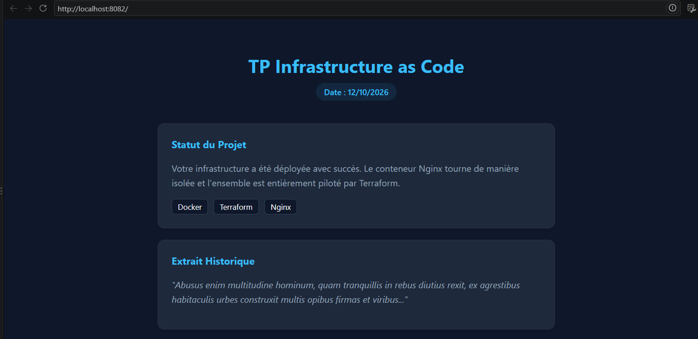
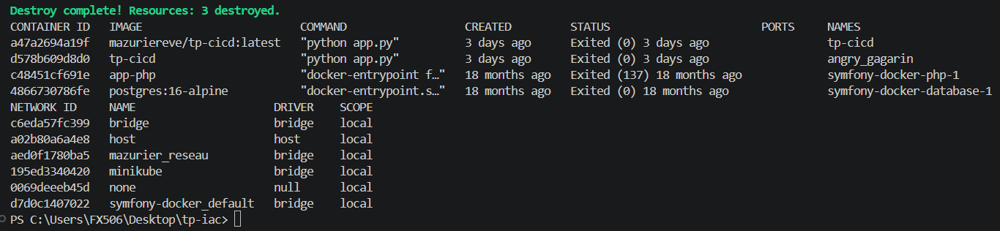
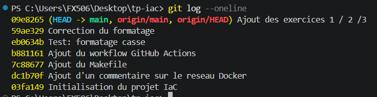
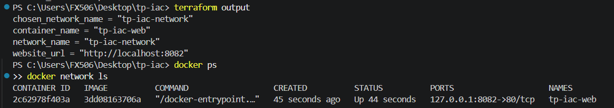
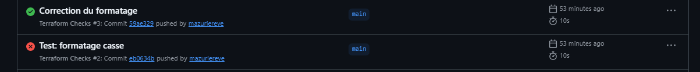
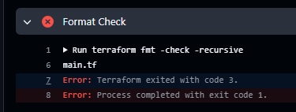

# TP — Infrastructure as Code avec Terraform et Docker

**Auteur :** *Eve Mazurier*
**Date du TP :** 12/10/2026
**Dépôt :** https://github.com/mazuriereve/tp-iac

Ce projet décrit et déploie, avec Terraform, un serveur **Nginx** dans un conteneur **Docker** local, relié à un réseau Docker dédié. Aucune ressource cloud n'est utilisée.

## Sommaire

1. [Architecture](#1-architecture)
2. [Prérequis et installation](#2-prérequis-et-installation)
3. [Structure du projet](#3-structure-du-projet)
4. [Déploiement](#4-déploiement)
5. [Tests](#5-tests)
6. [Destruction](#6-destruction)
7. [Réponses aux questions des sections 9 à 15](#7-réponses-aux-questions-des-sections-9-à-15)
8. [Partie 19 : exercices complémentaires](#8-partie-19--exercices-complémentaires)
9. [Partie 20 : questions de compréhension](#9-partie-20--questions-de-compréhension)

---

## 1. Architecture

```text
Fichiers Terraform
(main.tf, variables.tf, outputs.tf)
             |
             v
         Terraform
    init -> plan -> apply
             |
             v
       Moteur Docker
             |
             v
      Conteneur Nginx
       port interne 80
             |
             v
  http://localhost:8082
```

Terraform décrit l'état souhaité. Le provider `kreuzwerker/docker` traduit cette description en opérations sur Docker. Le projet déclare trois ressources :

| Ressource | Rôle |
|---|---|
| `docker_image.nginx` | image `nginx:alpine` |
| `docker_network.app_network` | réseau Docker dédié |
| `docker_container.web` | conteneur Nginx, port publié sur `127.0.0.1`, dossier `html/` monté en bind |

## 2. Prérequis et installation

Outils nécessaires : Terraform (>= 1.5.0), Docker Desktop, Git, un éditeur (Visual Studio Code) et `make` (pour le Makefile).

Installation sous Windows (PowerShell) :

```powershell
winget install Hashicorp.Terraform
winget install Git.Git
winget install GnuWin32.Make
```

Docker Desktop s'installe depuis le site officiel de Docker. Après l'installation, **fermer et rouvrir le terminal** (ou VS Code) pour que les commandes soient reconnues, puis **démarrer Docker Desktop**.

Vérification :

```powershell
terraform -version
docker --version
docker info
git --version
make --version
```


## 3. Structure du projet

```text
tp-iac/
├── main.tf                      # provider et ressources
├── variables.tf                 # variables (nom du conteneur, port, nom du réseau)
├── outputs.tf                   # informations affichées après déploiement
├── dev.tfvars                   # valeurs de l'environnement dev (non versionné)
├── Makefile                     # raccourcis des commandes Terraform
├── .gitignore                   # exclut l'état, .terraform/, les .tfvars...
├── .terraform.lock.hcl          # verrouillage des versions du provider (versionné)
├── html/
│   └── index.html               # page servie par Nginx
├── captures/                    # captures d'écran du rapport
└── .github/workflows/
    └── terraform.yml            # contrôles CI (init, fmt, validate)
```

## 4. Déploiement

Depuis le dossier du projet :

```powershell
terraform init
terraform fmt -recursive
terraform validate
terraform plan
terraform apply
terraform output
```

- `init` télécharge le provider Docker et crée `.terraform.lock.hcl`.
- `fmt` met les fichiers au format standard, `validate` vérifie la cohérence de la configuration.
- `plan` affiche les changements prévus **sans rien déployer**.
- `apply` crée les ressources après confirmation (`yes`).

Les mêmes commandes sont disponibles via le Makefile :

```powershell
make init
make fmt
make validate
make plan
```

> Le Makefile ne remplace pas la lecture du plan. Les commandes y doivent commencer par une **tabulation** et non un espace.

### Variables

| Variable | Valeur par défaut | Rôle |
|---|---|---|
| `container_name` | `tp-iac-web` | nom du conteneur |
| `external_port` | `8082` | port exposé sur la machine locale|
| `network_name` | `tp-iac-network` | nom du réseau Docker |

Pour utiliser un autre jeu de valeurs :

```powershell
terraform plan  -var-file="dev.tfvars"
terraform apply -var-file="dev.tfvars"
```


## 5. Tests

```powershell
terraform output
curl.exe http://localhost:8082
docker ps
docker network ls
docker network inspect tp-iac-network
```

Résultats attendus :

- la page HTML personnalisée s'affiche sur `http://localhost:8082` ;
- `docker ps` montre le conteneur `tp-iac-web` en `Up`, avec `127.0.0.1:8082->80/tcp` ;
- `docker network inspect` montre le conteneur rattaché au réseau.



## 6. Destruction

```powershell
terraform plan -destroy
terraform destroy
docker ps -a
docker network ls
terraform state list
```

Après la destruction, le conteneur et le réseau gérés par le projet n'existent plus et `terraform state list` ne renvoie rien. L'image Nginx peut rester en local, car `keep_locally = true`.



---

## 7. Réponses aux questions des sections 9 à 15

**9 — Différence entre un montage bind et la copie d'un fichier dans une image Docker**

Un montage bind relie directement un dossier de la machine hôte à un répertoire du conteneur : les deux partagent les mêmes fichiers et toute modification faite sur l'hôte est visible immédiatement dans le conteneur, sans rien reconstruire. À l'inverse, copier un fichier dans une image (instruction `COPY`) l'intègre à l'image au moment du build : le fichier est figé et n'a plus de lien avec l'original. Pour le mettre à jour, il faut reconstruire l'image. Le bind mount convient au développement, la copie dans l'image rend le déploiement reproductible et indépendant de l'hôte.

**10 — Réseau Docker dédié**

- *Pourquoi le conteneur est-il connecté à ce réseau ?* Le bloc `networks_advanced` de `main.tf` référence `docker_network.app_network`. Un réseau dédié isole les conteneurs du projet et permet la résolution de noms entre eux. `docker network inspect` montre le conteneur rattaché au réseau avec son adresse IP.
- *Intérêt de le déclarer dans Terraform ?* Il devient reproductible, versionnable, suivi dans l'état, créé avant le conteneur grâce à la dépendance, et supprimé proprement avec le reste du projet.
- *Suppression à la destruction :* vérifiée avec `docker network ls` après `terraform destroy` (voir section 6).

**11 — Différence entre `127.0.0.1` et une écoute sur toutes les interfaces**

`127.0.0.1` est l'interface de bouclage : le service n'est accessible que depuis la machine locale. Une écoute sur toutes les interfaces rend le service joignable depuis toutes les cartes réseau de l'hôte, donc peut être aussi sur les autres machines du réseau. Avec `ip = "127.0.0.1"`, on réduit la surface d'exposition. `docker ps` affiche `127.0.0.1:8082->80/tcp`.

**12 — Variables et `dev.tfvars`**

Avec `dev.tfvars` (`tp-iac-dev`, port 8081), Terraform a **remplacé** le conteneur et le réseau existants au lieu de créer un second environnement : un fichier de variables ne crée pas d'état séparé. Pour de vrais environnements distincts, il faut isoler les états (dossiers, workspaces ou backends différents). Un `terraform plan` sans `-var-file` après cet `apply` propose d'ailleurs de tout remplacer (`-/+`), ce qui illustre l'importance de lire le plan.

**13 — État Terraform**

1. `terraform state list` affiche `docker_container.web`, `docker_image.nginx` et `docker_network.app_network`.
2. `terraform state show docker_container.web` affiche tous les attributs connus de Terraform : identifiant, image, commande, nom, configuration réseau (IP, passerelle, MAC), montage bind, port publié, paramètres par défaut.
3. L'état relie le code aux ressources réelles ; perdu ou altéré, Terraform ne sait plus ce qu'il gère. Il peut aussi contenir des données sensibles en clair : son accès doit être restreint et il doit être sauvegardé.
4. Le publier dans un dépôt public exposerait ces informations, et l'historique Git les conserverait même après suppression. C'est pourquoi `*.tfstate` figure dans le `.gitignore`.

**14 — Dérive de configuration**

Voir l'exercice 5 (section 8).

**15 — Intérêt de l'historique Git**

L'historique Git enregistre chaque modification sous forme de commits datés, attribués à leur auteur et accompagnés d'un message.

- **Revue :** `git diff` montre précisément ce qui change dans le code avant de l'appliquer, ce qui complète `terraform plan`. Avec les pull requests, un autre membre de l'équipe relit avant l'intégration.
- **Collaboration :** les branches permettent de travailler en parallèle sans écraser le travail des autres, et l'historique indique qui a modifié quoi, quand et pourquoi.
- **Retour en arrière :** si un changement pose problème, on revient à une version antérieure (par exemple avec `git revert`) puis on réapplique Terraform pour restaurer l'infrastructure.

Historique du projet :

```powershell
git log --oneline
```



---

## 8. Partie 19 : exercices complémentaires

### Exercice 1 — Modifier le nom

Le `default` de `container_name` devient `tp-iac-web` dans `variables.tf`, puis :

```powershell
terraform fmt -recursive
terraform validate
terraform plan
```

**Changements prévus :** le conteneur et le réseau doivent être **détruits puis recréés** (`-/+`). Le nom d'un conteneur ne peut pas être modifié à chaud (`# forces replacement`), et comme le nom du réseau était construit avec `"${var.container_name}-network"`, il change lui aussi. Le port ne change pas, l'image n'est pas touchée, et les outputs affichent les nouvelles valeurs.

### Exercice 2 — Modifier le port

Le `default` de `external_port` devient `8082`, puis :

```powershell
terraform plan
terraform apply
curl.exe http://localhost:8082
```

Le plan montre que le changement de port force le remplacement du conteneur (`# forces replacement`). Après l'`apply`, `docker ps` affiche `127.0.0.1:8082->80/tcp` et la page répond sur `http://localhost:8082`.

### Exercice 3 — Ajouter une variable

Variable ajoutée dans `variables.tf` :

```hcl
variable "network_name" {
  description = "Nom du réseau Docker"
  type        = string
  default     = "tp-iac-network"
}
```

Utilisation dans `main.tf` :

```hcl
resource "docker_network" "app_network" {
  name = var.network_name
}
```

Output ajouté dans `outputs.tf` :

```hcl
output "chosen_network_name" {
  description = "Nom du réseau choisi via la variable"
  value       = var.network_name
}
```

Résultat de `terraform output` :

```text
chosen_network_name = "tp-iac-network"
container_name = "tp-iac-web"
network_name = "tp-iac-network"
website_url = "http://localhost:8082"
```

Le réseau n'est plus nommé d'après le conteneur et peut être changé indépendamment. Changer son nom force son remplacement, et le conteneur qui y est rattaché est recréé avec lui.



### Exercice 4 — Comprendre l'état

`terraform state list` affiche `docker_container.web`, `docker_image.nginx` et `docker_network.app_network`.

Le conteneur dépend de l'image, car il utilise `docker_image.nginx.image_id`, et du réseau, car il utilise `docker_network.app_network.name` dans son bloc `networks_advanced`. Terraform déduit ces dépendances automatiquement des références entre ressources. L'image et le réseau sont indépendants l'un de l'autre : Terraform les crée d'abord, puis le conteneur, et détruit dans l'ordre inverse. Sans ces dépendances, le conteneur pourrait être créé avant que l'image ou le réseau n'existe, ce qui provoquerait une erreur.


### Exercice 5 — Détecter une dérive

1. **Dérive provoquée :** `docker stop tp-iac-web`. `docker ps -a` montre le conteneur en `Exited (0)`, alors que le code le décrit comme devant tourner.
2. **Détection :** `terraform plan` rafraîchit l'état puis annonce `Plan: 1 to add, 0 to change, 0 to destroy`. L'image et le réseau sont inchangés, seul le conteneur est concerné. Terraform propose une **création** et non une modification : un conteneur arrêté est traité comme un conteneur absent, probablement à cause de `must_run = true`.
3. **Restauration :** `terraform apply` recrée le conteneur (`Apply complete! Resources: 1 added`). Son identifiant change (`2c62978f403a...` avant, `7dfa39296511...` après), ce qui prouve qu'il a été recréé et non redémarré.

Terraform compare l'état connu, la configuration et la réalité, et ramène l'infrastructure à l'état décrit par le code : une modification manuelle n'est donc pas durable.

### Exercice 6 — CI/CD

Le projet est poussé sur GitHub. Le workflow `.github/workflows/terraform.yml` exécute `terraform init -backend=false`, `terraform fmt -check -recursive` et `terraform validate` à chaque `push` et `pull_request`.

- **Premier run :** échec à l'étape `Initialize` avec l'erreur `504 Gateway Timeout returned from github.com` lors du téléchargement du provider. L'erreur venait d'un incident réseau passager et non du code : un *Re-run all jobs* a fait passer le workflow au vert.
- **Test de formatage :** le formatage de `main.tf` a été volontairement dégradé (alignement des `=` supprimé), puis poussé. Le run a échoué à l'étape `Format Check`, tandis que `Initialize` passait. Après correction avec `terraform fmt`, un nouveau push a ramené le workflow au vert.

Le contrôle CI bloque une erreur avant qu'elle n'aille plus loin. Il ne déploie rien : le runner GitHub ne peut pas piloter le Docker local.





### Exercice 7 — Nettoyage

```powershell
terraform plan -destroy
terraform destroy
docker ps -a
docker network ls
terraform state list
```

Le plan de destruction annonce 3 ressources (conteneur, réseau, image). Après `terraform destroy`, le conteneur `tp-iac-web` et le réseau `tp-iac-network` n'existent plus et l'état est vide.

**Pourquoi ne pas supprimer manuellement l'état pour nettoyer une infrastructure active ?** 
Parce que c'est l'état qui relie le code aux ressources réelles. Sans lui, Terraform ne sait plus qu'il gère un conteneur et un réseau : `terraform destroy` ne détruirait rien et les ressources resteraient actives hors de tout contrôle. Un `terraform apply` tenterait en plus de recréer des ressources déjà existantes, provoquant conflits ou doublons. Pour nettoyer proprement, il faut passer par `terraform destroy`, qui supprime les ressources puis met l'état à jour.

---

## 9. Partie 20 : questions de compréhension

**1. Différence entre `terraform init`, `terraform plan` et `terraform apply`**

- `init` initialise le répertoire de travail : il télécharge les providers et crée le dossier `.terraform` et le fichier de verrouillage `.terraform.lock.hcl`.
- `plan` compare le code, l'état et la réalité, et affiche les changements prévus **sans rien modifier**.
- `apply` exécute ces changements (après confirmation) et met à jour l'état.

**2. Rôle d'un provider Terraform**

C'est plugin qui traduit les ressources déclarées en appels vers l'API d'une plateforme. Ici, `kreuzwerker/docker` (version 3.9.0) traduit `docker_image`, `docker_network` et `docker_container` en opérations sur le moteur Docker.

**3. À quoi sert `terraform.tfstate` ?**

Il enregistre la correspondance entre les ressources déclarées dans le code et les objets réellement créés, avec leurs attributs et leurs dépendances. Terraform s'en sert pour calculer le plan, détecter les changements et savoir quoi détruire.

**4. Pourquoi utiliser des variables et des outputs ?**

Les variables permettent de paramétrer l'infrastructure (nom, port, réseau) sans réécrire les ressources, avec des valeurs par défaut et des validations. Les outputs affichent les informations utiles après le déploiement (URL, noms) et peuvent être réutilisés par d'autres outils ou modules.

**5. Qu'est-ce qu'une dérive de configuration ?**

C'est une différence entre la configuration attendue (le code) et la réalité de l'infrastructure, par exemple après une modification manuelle. Dans ce TP, l'arrêt manuel du conteneur avec `docker stop` en est un exemple : `terraform plan` l'a détectée.

**6. Différence entre Infrastructure as Code et configuration manuelle**

L'IaC décrit l'infrastructure dans du code : elle est reproductible, versionnée, relue, automatisable et documentée par le code lui-même. La configuration manuelle est difficile à reproduire, peu traçable et sujette aux erreurs et aux écarts entre environnements.

**7. Intérêt de Git dans un projet IaC**

Git garde l'historique de chaque modification de l'infrastructure : il facilite la revue (`git diff`, pull requests), la collaboration (branches, auteurs, messages) et le retour à une version antérieure en cas de problème.

**8. Différence entre un contrôle CI et un déploiement CD**

La CI (intégration continue) vérifie automatiquement le code à chaque push : ici le formatage et la validation de la configuration. Le CD (déploiement continu) déploie automatiquement l'infrastructure ou l'application vers un environnement après ces contrôles. Le workflow de ce TP ne fait que de la CI : il ne déploie rien, car le runner GitHub ne peut pas piloter le Docker de la machine locale.

**9. Pourquoi examiner le plan avant d'appliquer une modification ?**

Le plan montre exactement ce qui sera créé, modifié ou détruit. Il permet de repérer un remplacement (`-/+`) ou une destruction inattendue avant qu'elle n'ait lieu. Dans ce TP, un `plan` lancé sans `-var-file` après l'usage de `dev.tfvars` a proposé de détruire et recréer le conteneur et le réseau : appliquer sans lire aurait supprimé l'environnement existant.

**10. Précautions avec les fichiers d'état et les secrets**

- ne pas versionner l'état ni les fichiers de variables sensibles (`.gitignore` : `*.tfstate`, `*.tfvars`) ;
- ne pas écrire de secrets en clair dans le code, utiliser des variables marquées sensibles ou un gestionnaire de secrets ;
- en équipe, stocker l'état dans un backend distant, chiffré, avec verrouillage et accès restreint ;
- sauvegarder l'état ;
- ne jamais l'éditer ni le supprimer à la main, et passer par les commandes Terraform.


---
